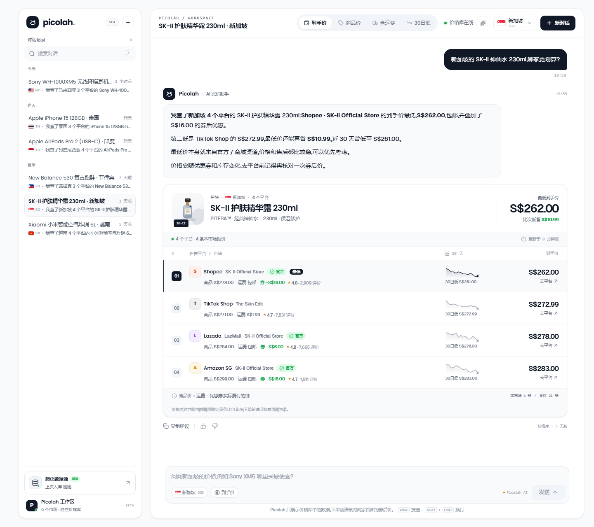
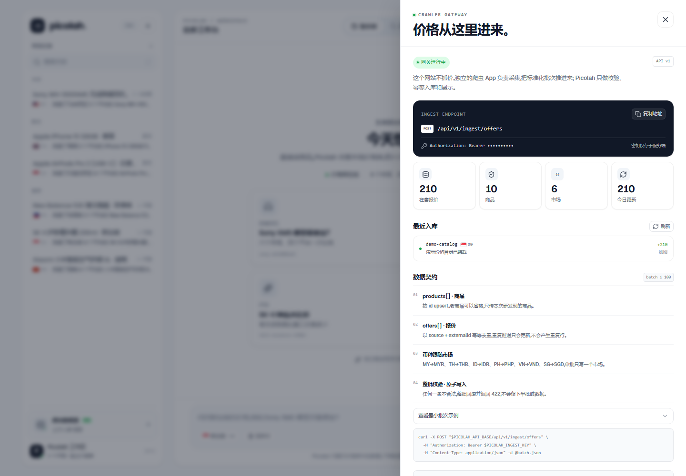
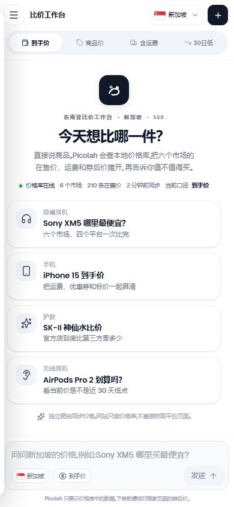

# Picolah

**东南亚比价工作台 · Southeast Asia price copilot**

左边是对话历史，右边是比价工作区。问一句想买的东西，Picolah 会把六个市场的在售报价、运费和券后价摊开，用一张结果卡告诉你最低价、和次低价差多少，以及要不要为官方店多付一点。

网站本身**不抓价格**。独立爬虫 App 负责采集，通过数据接入 API 把标准化批次推进来；Picolah 只负责校验、入库、比价和展示。

视觉方向参照 [TangMi](https://github.com/SRLove-git/TangMi) 的浅色工作台语言：近黑主色、白色大圆角卡片、冷灰表面、轻边框、玻璃顶栏，以及 Poppins / Geist Sans 字体组合。


## 已实现

- **TangMi 风格工作台**：白色浮层卡片 + 冷灰底、近黑主按钮、胶囊式导航、圆角价格卡，浅色主题优先。
- **对话式比价**：SSE 流式回答，助手先定位商品与市场，再展示结构化的平台报价卡。
- **四种价格口径**：顶部一键切换「到手价 / 商品价 / 含运费 / 30 日低」，列表会按当前口径重新排序并高亮对应数字。
- **六国本地化**：新加坡、马来西亚、泰国、印度尼西亚、菲律宾、越南；本地货币、当地主流平台和国旗图标。
- **真实对话持久化**：SQLite 存储会话、消息、商品、报价、价格点和爬虫批次；刷新页面会恢复上次对话。
- **独立数据接入**：带 Bearer 鉴权的批量写接口，按 `source + externalId` 幂等 upsert，整批原子写入。
- **LLM 接入**：兼容 OpenAI 协议的 Chat Completions（默认 DeepSeek）。价格检索始终在本地完成，模型只拿到价格库里的数据；比价建议严格基于报价，打招呼、没匹配到型号等对话也由模型自然回应，不再套用固定文案。没有配置 Key 时自动使用本地摘要器。
- **模型意图路由**：每条消息先由模型判断「比价 / 推荐 / 打招呼 / 闲聊」，抽取品类、预算和品牌；本地关键词匹配保留为兜底。
- **需求型推荐**：按预算、品类和用途从价格库挑 1–4 款，回答里给推荐理由和价差，下方展示可直接点开的商品卡。
- **图片找货**：支持上传或手机拍照，视觉模型识别品牌/型号并匹配价格库；没有收录时按品类推荐替代款。
- **可操作的网关面板**：数据源状态、最近入库、接口地址、字段契约和 curl 示例都在界面内。
- **响应式界面**：桌面为侧栏卡片 + 工作区卡片，移动端切换为抽屉式历史记录与单列比价卡。

## 界面预览

比价对话：模型建议 + 可按价格口径重排的完整报价卡。



独立爬虫网关：状态、最近批次、字段契约和接入地址都在这里。



移动端：



## 视觉语言

参考 TangMi 的 design language，而不是复制它的业务界面：

| Token | 值 | 用途 |
| --- | --- | --- |
| Workspace | `#F8FAFC` | 页面底色、次级表面 |
| Card | `#FFFFFF` | 侧栏、主工作区、结果卡 |
| Subtle | `#F1F5F9` | 胶囊容器、图标底、弱按钮 |
| Border | `#E5E7EB` | 卡片和控件描边 |
| Ink | `#111827` | 主文字、主按钮、价格 |
| Muted | `#6B7280` | 辅助说明、元数据 |
| Success | `#16A34A` | 在线状态、官方店、省钱提示 |
| Warning | `#D97706` | 本地模式、星标 |
| Info | `#2563EB` | 信息与对比辅助色 |

- 字体：Poppins 负责 UI / 数字标题，Geist Sans 负责正文与价格明细，中文自动回退到系统无衬线字体。
- 卡片：20px 大圆角、1px 冷灰描边、低对比阴影；桌面侧栏固定 300px。
- 控件：胶囊式价格口径切换、近黑主 CTA、图标按钮和圆角下拉。
- 字体文件位于 `public/fonts/`（Poppins / Geist Sans，SIL OFL）。

## 快速开始

环境要求：**Node.js 24+**、**pnpm**。

```bash
pnpm install
cp .env.example .env        # Windows: Copy-Item .env.example .env
pnpm dev
```

打开 **http://127.0.0.1:5173**。API 在 **http://127.0.0.1:8787**。

首次启动会自动建库、写入 10 个商品 / 210 条演示报价，并生成几段示例对话。演示数据只用于把界面和链路跑通，不代表真实市场价。

重置演示库：

```bash
pnpm seed
```

## 价格口径

| 口径 | 计算方式 | 用途 |
| --- | --- | --- |
| 到手价 | 商品价 + 运费 − 优惠券 | 实际要付的钱，默认口径 |
| 商品价 | 商品标价 | 看平台基础定价 |
| 含运费 | 商品价 + 运费 | 对比物流成本，不扣券 |
| 30 日低 | 该报价近 30 天最低价格点 | 判断现在是不是好价 |

金额始终使用市场本地货币，不做自动换汇。

## 架构

```text
┌─────────────────────┐        HTTPS + Bearer token        ┌──────────────────────────┐
│  独立爬虫 App        │  ───────────────────────────────▶  │  POST /api/v1/ingest/    │
│  Shopee / Lazada /  │         标准化批次 (JSON)           │  offers                  │
│  TikTok Shop / ...  │                                    │                          │
└─────────────────────┘                                    │  Node.js + Express       │
                                                           │  SQLite (node:sqlite)    │
┌─────────────────────┐        REST + SSE                  │                          │
│  React 工作台        │  ◀──────────────────────────────▶  │  商品 / 报价 / 价格点     │
│  Vite + TypeScript  │       /api/chat, /api/conversations│  对话 / 批次              │
└─────────────────────┘                                    └────────────┬─────────────┘
                                                                        │ 意图 / 识别 / 回答
                                                                        ▼
                                                           ┌──────────────────────────┐
                                                           │ OpenAI-compatible LLM    │
                                                           │ intent · vision · answer │
                                                           │ (DeepSeek by default)    │
                                                           └──────────────────────────┘
```

### 为什么把爬虫拆出去

- 采集需要代理、频控、验证码处理和频繁改版适配，和展示层的节奏完全不同。
- 网站不承担采集失败风险；爬虫挂了，已有价格仍可正常浏览。
- 采集端可以独立部署在目标市场，独立扩容、独立监控。
- 接入层把「采集格式」和「展示格式」隔开，后续接入更多数据源不会污染前端。

### 本地价格链路

1. 爬虫把批次推到 `POST /api/v1/ingest/offers`。
2. 服务端校验市场、币种、平台和商品引用，整批原子写入。
3. 报价按 `(source, externalId)` 幂等更新；同时写入价格点。
4. 用户提问后，服务端先用 LLM 做意图解析（比价 / 推荐 / 打招呼 / 闲聊）并抽取品类、预算；如果带图片，先由视觉模型识别商品。本地关键词 / 别名匹配作为兜底。
5. 按意图读取当前市场报价，按到手价排序，生成结构化的 `Comparison`（单品比价或推荐候选）。
6. 有在售报价时，LLM 只基于这份 `Comparison` 写比价建议；推荐场景由模型从候选商品里挑选并说明理由；没有匹配到商品时，也用同一份上下文生成自然引导语。前端用 SSE 逐段渲染，并把结果卡插在正文后。

## LLM 配置

复制 `.env.example` 后填写：

```dotenv
LLM_API_KEY=sk-...
LLM_BASE_URL=https://api.deepseek.com
LLM_MODEL=deepseek-chat
LLM_PROVIDER=DeepSeek
# 可选：意图解析与图片识别模型
LLM_INTENT_MODEL=deepseek-chat
LLM_VISION_MODEL=deepseek-flash
```

任何兼容 OpenAI `POST /chat/completions` 的服务都可以使用。比如：

```dotenv
LLM_BASE_URL=https://api.openai.com/v1
LLM_MODEL=gpt-4.1-mini
LLM_PROVIDER=OpenAI
LLM_INTENT_MODEL=gpt-4.1-mini
LLM_VISION_MODEL=gpt-4.1-mini
```

换用其他服务商时，记得把 `LLM_INTENT_MODEL` 和 `LLM_VISION_MODEL` 也改成对应模型；视觉模型必须支持图片输入。

- Key 只存在服务端，前端拿不到。
- 未配置 Key 时界面显示「Picolah AI · 本地摘要」，仍可完整比价。
- 模型请求失败会自动回退到本地摘要，不会让对话空白。
- 意图解析和图片识别分别使用 `LLM_INTENT_MODEL` / `LLM_VISION_MODEL`，默认 `deepseek-chat` / `deepseek-flash`。
- 系统提示词要求模型只能引用价格库数据：比价建议限制为 2–3 段、220 字以内，推荐和引导语不超过 220 字。
- `POST /api/chat` 额外接受可选 `image`（`data:image/...;base64,...`）。前端会先把图片压到最长边 1280px、体积不超过 3MB，支持 JPG / PNG / WebP；手机浏览器可直接调用相机拍照。
- 图片会发送给视觉模型，并以压缩后的 data URL 保存在 SQLite 消息元数据里，刷新后仍能看到。生产环境建议换成对象存储 + 签名 URL，并增加保留策略。

## 数据接入

完整字段和错误码见 [docs/ingest-api.md](docs/ingest-api.md)。

```http
POST /api/v1/ingest/offers
Authorization: Bearer <INGEST_API_KEY>
Content-Type: application/json
```

```json
{
  "source": "shopee-my-crawler",
  "country": "MY",
  "products": [
    {
      "id": "sony-wh1000xm5",
      "name": "Sony WH-1000XM5 无线降噪耳机",
      "brand": "Sony",
      "category": "耳机",
      "visual": "headphones"
    }
  ],
  "offers": [
    {
      "externalId": "shopee-my-8821",
      "productId": "sony-wh1000xm5",
      "platformId": "shopee",
      "seller": "Sony Official Store",
      "itemPrice": 1399,
      "shippingFee": 0,
      "discount": 100,
      "url": "https://shopee.com.my/product/8821",
      "isOfficial": true
    }
  ]
}
```

```json
{
  "ok": true,
  "runId": "…",
  "received": 1,
  "created": 1,
  "updated": 0,
  "productsUpserted": 1,
  "status": "ok"
}
```

在网页左下角打开「爬虫数据源」，可以查看实时状态、最近批次和可复制的接入地址。

## 目录

```text
picolah/
├── src/                     # React 工作台
│   ├── components/          # 侧栏、顶栏、比价卡、数据接入抽屉、国旗 / 商品插画
│   ├── lib/                 # API / SSE 客户端、格式化
│   ├── App.tsx              # 会话状态、流式消息、导航
│   └── styles.css           # 设计系统与响应式
├── server/
│   ├── index.ts             # Express 入口与静态资源托管
│   ├── db.ts                # node:sqlite 初始化和 schema
│   ├── seed.ts              # 演示数据 + 示例对话
│   ├── catalog-data.ts      # 商品与报价生成器
│   ├── repo.ts              # 商品 / 报价 / 会话查询
│   ├── query.ts             # 国家识别、商品别名匹配
│   ├── llm.ts               # OpenAI-compatible SSE 流
│   ├── copy.ts              # 本地兜底摘要器
│   └── routes/              # chat / conversations / config / ingest
├── shared/types.ts          # 前后端共享类型、市场与平台定义
├── docs/ingest-api.md       # 爬虫接入契约
└── data/                    # SQLite（首次运行自动生成，已 gitignore）
```

## 命令

| 命令 | 说明 |
| --- | --- |
| `pnpm dev` | 同时启动 API 与 Vite |
| `pnpm dev:api` | 仅启动 API |
| `pnpm dev:web` | 仅启动 Vite |
| `pnpm build` | 类型检查 + 生产构建 |
| `pnpm start` | 启动 API（若存在 `dist/` 则同时托管前端） |
| `pnpm seed` | 清空并重建演示库 |
| `pnpm test` | 国家 / 商品匹配与货币格式化测试 |

生产模式：

```bash
pnpm build
NODE_ENV=production pnpm start
```

## 环境变量

| 变量 | 默认值 | 说明 |
| --- | --- | --- |
| `PORT` | `8787` | API 端口 |
| `INGEST_API_KEY` | `pcl_dev_crawler_key` | 爬虫写入密钥，生产必须更换 |
| `CORS_ORIGINS` | `http://localhost:5173,http://127.0.0.1:5173` | 允许跨域的来源，逗号分隔 |
| `LLM_API_KEY` | 空 | 空则启用本地摘要 |
| `LLM_BASE_URL` | `https://api.deepseek.com` | OpenAI-compatible base URL |
| `LLM_MODEL` | `deepseek-chat` | 回答生成模型名 |
| `LLM_INTENT_MODEL` | `deepseek-chat` | 意图解析模型名 |
| `LLM_VISION_MODEL` | `deepseek-flash` | 图片识别模型名（需支持图片输入） |
| `LLM_PROVIDER` | `DeepSeek` | 界面上显示的服务商名 |
| `PICOLAH_DB_PATH` | `data/picolah.db` | 可选数据库路径 |

## 安全与边界

- 这是单工作区演示应用，**会话接口没有登录鉴权**。正式上线前需要加用户体系，并把会话 / 网关状态限制到管理员。
- 生产环境务必更换 `INGEST_API_KEY`；建议再加 IP allowlist、请求签名、速率限制和审计日志。
- 上传图片会发送给配置的视觉模型，并保存在 SQLite 消息元数据中；生产环境应改用对象存储、签名 URL 和明确的保留 / 删除策略。
- 演示报价、店铺名和平台链接都是生成数据，链接指向平台搜索页。真实上线时应只展示爬虫回传的真实商品 URL。
- 当前为 SQLite 单进程模型。多实例部署时建议换 PostgreSQL，并把价格点写入改成异步队列。
- 比价结果仅供参考，页面已展示「以商家页面为准」的提示。

## 接下来可以做什么

- 商品级价格提醒和「到价通知」。
- 一次比较多款商品，或按类目做价格带分布。
- 接入真实类目树、规格（SKU）和图片 CDN。
- 爬虫批次监控、失败重试和异常价格检测（价格突降 / 突涨）。
- 用户账户、收藏、分享卡片和协作工作区。
- 对 LLM 回答做引用校验，把每句建议绑定到 `offerId`。

## License

Private prototype. No license granted yet.
