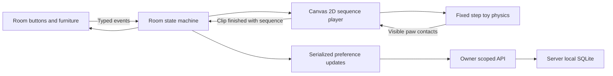

# Capybara room: state machine, events and sequence frames

Implemented 2026-11-01. The existing account, wardrobe, journal and shopping XP remain the sources of their respective data.

## Runtime

`shared/capy-room.ts` defines the finite states and typed events. React and the player subscribe to one store. The player reports `CLIP_FINISHED` with the action sequence number; a stale completion cannot interrupt a newer action. Sleeping and playing have no completion timeout. Dressing preserves an ongoing nap or game.



`capy-play.ts` only simulates travel, jump anticipation/landing, ball bounce, bubble contacts and the swing pendulum. It no longer completes actions independently. Contacts use the same per-frame paw positions that were baked with the image, rather than a timeout or a click count.

`capy-play-scene.ts` uses Canvas 2D. The room no longer creates a WebGL context, loads Three.js, builds meshes or computes lighting at runtime. The original approved images, six complete outfits and bag-supported charms are preserved. The Home companion's separate renderer is unchanged.

## Storage

SQLite gains an additive `capybara_room` table with `owner_id`, `sleeping`, `evening`, `revision` and `updated_at`. Existing SQLite files migrate at startup with `CREATE TABLE IF NOT EXISTS`; wardrobe and journal rows are not rewritten. The alternate PostgreSQL schema contains the equivalent table.

- `GET /api/capybara/room` returns the owner's saved preferences, or revision 0 defaults without creating a row.
- `PATCH /api/capybara/room` accepts `{ revision, changes: { sleeping?, evening? } }`; at least one boolean is required. Unknown fields are rejected.
- Writes conditionally increment the revision inside a transaction. A stale revision returns HTTP 409 and the current room.
- The client serializes writes, rebases only pending fields on conflict, retries absolute values instead of toggles, and retains the newest intention after a failed response. Failed saves have a visible retry control.
- Events fired while the first request is pending are replayed over the stored state. Account switches dispose the old connection and renderer.
- A new account inherits the guest room on login. Existing account preferences win. Account export includes the room; account deletion removes it.

Transient games, frame times and contact counts are deliberately not persisted. Returning to the room resumes sleep/lighting, without replaying an old throw or changing shopping XP.

## Sequence assets and maintenance

`src/assets/capy-frames-v1` contains 60 lazy-loaded WebP atlases: 16 frames of 384 × 482 pixels per atlas, including gutters for motion. The five original poses have expression cycles; standing variants have walk and left/right kick cycles. There are complete dressed and bag-supported variants. All source pixels derive from the existing approved images; this change does not generate a replacement character.

The player holds at most three decoded atlases (about 34 MiB of pixel data), plus a small compositing surface. Old bitmaps and pending loads are released on eviction/unmount. Idle expression cycles ping-pong. Action changes crossfade in a separate premultiplied-alpha surface so the room does not show through the fur. A failed atlas falls back to the matching source portrait. A failed Canvas context retains the SVG character and account tools.

Pause, hidden tabs, offscreen rooms, open dialogs and reduced motion stop continuous frame drawing. Reduced motion shows still results of the same toy simulation. Short action completion timers also pause with the room.

Rebake from the web directory, with Node, Chrome, ffmpeg and cwebp available:

```sh
npx vite --host 127.0.0.1 --port 5178
node scripts/capy-frames/generate.mjs
```

The baker writes to `/tmp/picolah-capy-frames-v1` by default, keeping generated files outside Vite's file watcher. Set `CAPY_FRAME_OUT` to another staging directory if needed. Review the staged sheets, then copy all WebP files and `manifest.json` into `src/assets/capy-frames-v1`. Passing variant IDs generates only those variants and merges their metadata. Three.js is used only by this offline baker and its source-art tests.

The compact manifest stores quantized frame coordinates. `capy-frame-data.ts` decodes the same metadata for the runtime and contact regression tests.

## Validation

- Pure state-machine tests cover interruptions, late completion, persistent sleep, hydration and game events.
- Sync tests cover queued sleep/wake, concurrent-tab conflicts, a lost successful response and disposal.
- API tests use a real temporary SQLite file, reopen it in a second Node process, and check identity isolation, validation, concurrent writes, login merge, export, deletion and unchanged shopping XP.
- Browser coverage includes 1440/390/320 px rooms, four physical toys, six outfits, journal interactions, persistence/retry, reduced motion, pause/background behavior, keyboard/touch, no-WebGL operation and asset/context fallbacks.
