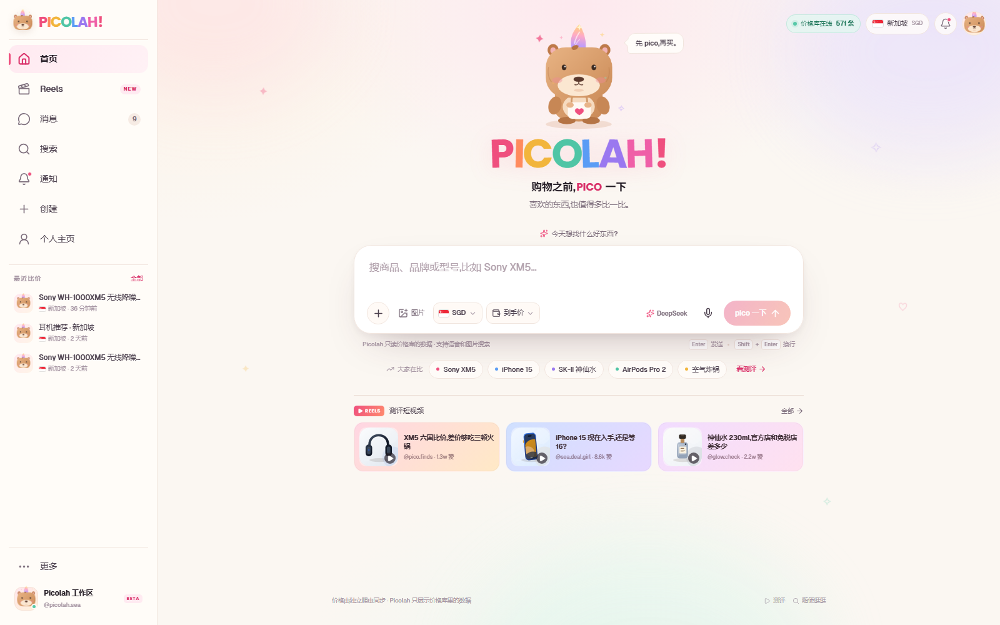
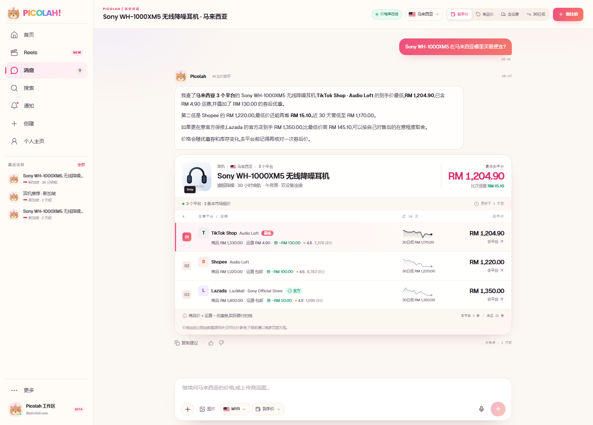
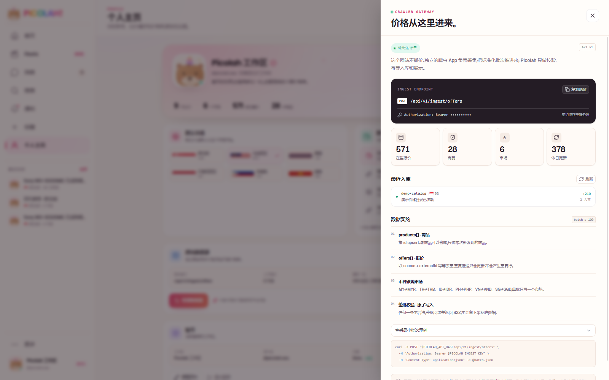
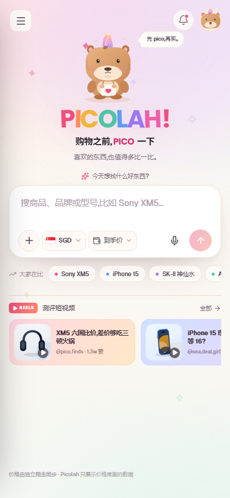

# Picolah

**购物之前，PICO 一下 · Southeast Asia price copilot**

Picolah 把比价做成一件轻松的小事。首页像 Google 一样干净，中间是一个 ChatGPT 式的大输入框，左边是首页、消息、短视频和数据源，下面留着最近对话，左下角是账号管理。问一句想买的东西，它会把六个市场的在售报价、运费和券后价摊开，用一张结果卡告诉你最低价、和次低价差多少，以及要不要为官方店多付一点。

网站本身**不抓价格**。独立爬虫 App 负责采集，通过数据接入 API 把标准化批次推进来；Picolah 只负责校验、入库、比价和展示。

> 本目录是**网站项目**（`web/`）。爬虫项目单独放在 `../crawler/`（Bright Data 采集，Lazada 已实测 SG、Shopee 实验性）；两者只通过 HTTP 数据接入契约通信。

视觉方向来自「带角的卡皮巴拉」：奶油纸色底、覆盆子粉强调色、淡紫与薄荷点缀、Poppins 彩色字标，以及一只会漂浮、眨眼、晃角的卡皮巴拉吉祥物。



## 已实现

- **PICOLAH 视觉系统**：奶油纸色画布、粉色渐变主按钮、淡紫 / 薄荷辅助色、Poppins 彩色字标与 Geist 正文，整体明亮、年轻、Instagram 感。
- **Google 式首页**：只保留吉祥物、字标、tagline 和一个搜索框；推荐词收在下方，打开页面不抢注意力。
- **ChatGPT 式输入框**：大圆角、可换行、支持语音输入、图片上传 / 拍照搜同款、拖拽图片；底栏直接切换市场与价格口径，右侧显示当前模型。
- **卡皮巴拉吉祥物**：纯 SVG 绘制，漂浮、眨眼、耳朵和独角会轻轻摆动，星星会闪；从首页到对话头像保持一致。
- **左侧导航**：首页、消息、短视频、数据源四项，下面是最近对话列表；左下角固定账号管理入口（参考 Instagram），移动端变为抽屉。
- **商品测评短视频**：Instagram 式竖屏 Reels，测评 / 好价短片可上下切换，点赞、收藏、分享和「去比价」，首页也有三张精选卡片。
- **消息 / 账号**：消息页保留完整比价对话；账号页集中管理登录状态、默认市场、价格口径、爬虫数据源和账号安全。
- **商品搜索 / 分类发现**：侧栏「搜索」按关键词或品类浏览价格库，点商品直接带着当前市场进入比价对话。
- **对话式比价**：SSE 流式回答，助手先定位商品与市场，再展示结构化的平台报价卡。
- **四种价格口径**：顶部和输入框都能切换「到手价 / 商品价 / 含运费 / 30 日低」，列表会按当前口径重新排序并高亮对应数字。
- **六国本地化**：新加坡、马来西亚、泰国、印度尼西亚、菲律宾、越南；本地货币、当地主流平台和国旗图标。
- **真实对话持久化**：SQLite 存储会话、消息、商品、报价、价格点和爬虫批次；从「消息」列表可以继续任意一段对话。
- **独立数据接入**：带 Bearer 鉴权的批量写接口，按 `source + externalId` 幂等 upsert，整批原子写入。
- **LLM 接入**：兼容 OpenAI 协议的 Chat Completions（默认 DeepSeek）。价格检索始终在本地完成，模型只拿到价格库里的数据；比价建议严格基于报价，打招呼、没匹配到型号等对话也由模型自然回应。没有配置 Key 时自动使用本地摘要器。
- **模型意图路由**：每条消息先由模型判断「比价 / 推荐 / 打招呼 / 闲聊」，抽取品类、预算和品牌；本地关键词匹配保留为兜底。
- **需求型推荐**：按预算、品类和用途从价格库挑 1–4 款，回答里给推荐理由和价差，下方展示可直接点开的商品卡。
- **图片找货**：支持上传或手机拍照，视觉模型识别品牌/型号并匹配价格库；没有收录时按品类推荐替代款。
- **可操作的网关面板**：数据源状态、最近入库、接口地址、字段契约和 curl 示例都在界面内。
- **响应式界面**：桌面为 252px 侧栏 + 主工作区；1100px 以下收成图标栏；820px 以下切换为抽屉式导航与单列卡片。
- **可运行的 mock**：`pnpm mock` 是一支模拟爬虫，按市场轮询把真实格式的批次推进来，价格、库存、今日更新和 30 日曲线都会持续变化；`?mock=1` 则完全离线，只用前端内置数据跑通整套工作台。
- **账号与个人数据**：注册 / 登录 / 登出、匿名购物画像、关注清单与降价提醒、账号数据导出与注销；隐私政策和服务条款从侧栏可直接打开。
- **PWA 与可访问性**：Web App Manifest、生产环境 Service Worker（只缓存静态资源）、跳到主要内容链接、键盘焦点样式和 reduced-motion 适配。
- **可观测性**：`/metrics` 暴露 Prometheus 文本指标（请求量、5xx、延迟直方图、在途请求、内存/运行时长）；生产需配置 `METRICS_TOKEN`。

## 界面预览

首页：Google 式留白、彩色字标、卡皮巴拉吉祥物和 ChatGPT 式大输入框。


比价对话：模型建议 + 可按价格口径重排的完整报价卡。



独立爬虫网关：状态、最近批次、字段契约和接入地址都在这里。



移动端：



## 视觉语言

| Token | 值 | 用途 |
| --- | --- | --- |
| Paper | `#FBF7F2` | 页面底色、奶油纸张感 |
| Card | `#FFFDFA` | 侧栏、工作区、结果卡 |
| Ink | `#241C25` | 主文字、主按钮、价格 |
| Muted | `#7E6F7D` | 辅助说明、元数据 |
| Raspberry | `#EF4F7E` | 主 CTA、选中态、重点数字 |
| Lilac | `#B79BFF` | 次级强调、渐变装饰 |
| Mint | `#57C9A8` | 在线状态、省钱提示 |
| Butter | `#F2B53C` | 标签、星标、促销贴纸 |
| Line | `#F1E5DE` | 卡片和控件描边 |

- 字体：Poppins 负责彩色字标、标题和数字，Geist Sans 负责正文与控制项，中文自动回退到系统无衬线字体。
- 形状：大圆角（18–28px）、软阴影、白色玻璃浮层；侧栏 252px，1100px 以下收成 78px 图标栏。
- 动效：吉祥物漂浮 / 眨眼 / 晃角，页面淡入；全部尊重 `prefers-reduced-motion`。
- 字体文件位于 `public/fonts/`（Poppins / Geist Sans，SIL OFL）。

## 快速开始

环境要求：**Node.js 24+**、**pnpm**。所有命令都可以在仓库根目录执行（会转发到 `web/`）。

```bash
pnpm install
cp web/.env.example web/.env   # Windows: Copy-Item web\.env.example web\.env
pnpm dev
```

也可以进入本目录单独启动：

```bash
cd web
pnpm install    # 若根目录已经 install 过可跳过
pnpm dev
```

打开 **http://127.0.0.1:5173**。API 在 **http://127.0.0.1:8787**。

首次启动会自动建库、写入 **28 个商品 / 588 条演示报价**（六个市场 × 各市场平台矩阵），并生成 8 段示例对话。演示数据只用于把界面和链路跑通，不代表真实市场价。

想让数据动起来（模拟爬虫每 2 分钟推一批）：

```bash
pnpm mock          # 常驻；Windows 另开一个终端
pnpm mock:once     # 只推一批，适合冒烟测试
```

只想看纯前端演示、不启动 API：打开 **http://127.0.0.1:5173/?mock=1**（或构建时设 `VITE_MOCK=1`）。

重置演示库：

```bash
pnpm seed
```

## 价格口径

| 口径 | 计算方式 | 用途 |
| --- | --- | --- |
| 到手价 | 商品价 + 运费 − 优惠券 | 实际要付的钱，默认口径 |
| 商品价 | 商品标价 | 看平台基础定价 |
| 含运费 | 商品价 + 运费 | 对比物流成本，不扣券 |
| 30 日低 | 该报价近 30 天最低价格点 | 判断现在是不是好价 |

金额始终使用市场本地货币，不做自动换汇。

## 架构

```text
┌─────────────────────┐        HTTPS + Bearer token        ┌──────────────────────────┐
│  独立爬虫 App        │  ───────────────────────────────▶  │  POST /api/v1/ingest/    │
│  Shopee / Lazada /  │         标准化批次 (JSON)           │  offers                  │
│  TikTok Shop / ...  │                                    │                          │
└─────────────────────┘                                    │  Node.js + Express       │
                                                           │  SQLite (node:sqlite)    │
┌─────────────────────┐        REST + SSE                  │                          │
│  React 工作台        │  ◀──────────────────────────────▶  │  商品 / 报价 / 价格点     │
│  Vite + TypeScript  │       /api/chat, /api/conversations│  对话 / 批次              │
└─────────────────────┘                                    └────────────┬─────────────┘
                                                                        │ 意图 / 识别 / 回答
                                                                        ▼
                                                           ┌──────────────────────────┐
                                                           │ OpenAI-compatible LLM    │
                                                           │ intent · vision · answer │
                                                           │ (DeepSeek by default)    │
                                                           └──────────────────────────┘
```

### 为什么把爬虫拆出去

- 采集需要代理、频控、验证码处理和频繁改版适配，和展示层的节奏完全不同。
- 爬虫是独立项目（[`../crawler/`](../crawler/README.md)），只依赖 HTTP 契约，不 import 网站代码。
- 网站不承担采集失败风险；爬虫挂了，已有价格仍可正常浏览。
- 采集端可以独立部署在目标市场，独立扩容、独立监控。
- 接入层把「采集格式」和「展示格式」隔开，后续接入更多数据源不会污染前端。

### 本地价格链路

1. 爬虫把批次推到 `POST /api/v1/ingest/offers`。
2. 服务端校验市场、币种、平台和商品引用，整批原子写入。
3. 报价按 `(source, externalId)` 幂等更新；同时写入价格点。
4. 用户提问后，服务端先用 LLM 做意图解析（比价 / 推荐 / 打招呼 / 闲聊）并抽取品类、预算；如果带图片，先由视觉模型识别商品。本地关键词 / 别名匹配作为兜底。
5. 按意图读取当前市场报价，按到手价排序，生成结构化的 `Comparison`（单品比价或推荐候选）。
6. 有在售报价时，LLM 只基于这份 `Comparison` 写比价建议；推荐场景由模型从候选商品里挑选并说明理由；没有匹配到商品时，也用同一份上下文生成自然引导语。前端用 SSE 逐段渲染，并把结果卡插在正文后。

## LLM 配置

复制 `.env.example` 后填写：

```dotenv
LLM_API_KEY=sk-...
LLM_BASE_URL=https://api.deepseek.com
LLM_MODEL=deepseek-chat
LLM_PROVIDER=DeepSeek
# 可选：意图解析与图片识别模型
LLM_INTENT_MODEL=deepseek-chat
LLM_VISION_MODEL=deepseek-flash
```

任何兼容 OpenAI `POST /chat/completions` 的服务都可以使用。比如：

```dotenv
LLM_BASE_URL=https://api.openai.com/v1
LLM_MODEL=gpt-4.1-mini
LLM_PROVIDER=OpenAI
LLM_INTENT_MODEL=gpt-4.1-mini
LLM_VISION_MODEL=gpt-4.1-mini
```

换用其他服务商时，记得把 `LLM_INTENT_MODEL` 和 `LLM_VISION_MODEL` 也改成对应模型；视觉模型必须支持图片输入。

- Key 只存在服务端，前端拿不到。
- 未配置 Key 时界面显示「Picolah AI · 本地摘要」，仍可完整比价。
- 模型请求失败会自动回退到本地摘要，不会让对话空白。
- 意图解析和图片识别分别使用 `LLM_INTENT_MODEL` / `LLM_VISION_MODEL`，默认 `deepseek-chat` / `deepseek-flash`。
- 系统提示词要求模型只能引用价格库数据：比价建议限制为 2–3 段、220 字以内，推荐和引导语不超过 220 字。
- `POST /api/chat` 额外接受可选 `image`（`data:image/...;base64,...`）。前端会先把图片压到最长边 1280px、体积不超过 3MB，支持 JPG / PNG / WebP；手机浏览器可直接调用相机拍照。
- 图片会发送给视觉模型，并以压缩后的 data URL 保存在 SQLite 消息元数据里，刷新后仍能看到。生产环境建议换成对象存储 + 签名 URL，并增加保留策略。

## 数据接入

完整字段和错误码见 [../docs/ingest-api.md](../docs/ingest-api.md)（跨项目契约，爬虫侧也以此为准）。

```http
POST /api/v1/ingest/offers
Authorization: Bearer <INGEST_API_KEY>
Content-Type: application/json
```

```json
{
  "source": "shopee-my-crawler",
  "country": "MY",
  "products": [
    {
      "id": "sony-wh1000xm5",
      "name": "Sony WH-1000XM5 无线降噪耳机",
      "brand": "Sony",
      "category": "耳机",
      "visual": "headphones"
    }
  ],
  "offers": [
    {
      "externalId": "shopee-my-8821",
      "productId": "sony-wh1000xm5",
      "platformId": "shopee",
      "seller": "Sony Official Store",
      "itemPrice": 1399,
      "shippingFee": 0,
      "discount": 100,
      "url": "https://shopee.com.my/product/8821",
      "isOfficial": true
    }
  ]
}
```

```json
{
  "ok": true,
  "runId": "…",
  "received": 1,
  "created": 1,
  "updated": 0,
  "productsUpserted": 1,
  "status": "ok"
}
```

在网页左下角打开「爬虫数据源」，可以查看实时状态、最近批次和可复制的接入地址。

## 目录

```text
web/                         # 网站项目（@picolah/web）
├── src/                     # React 工作台
│   ├── components/          # 侧栏、顶栏、比价卡、数据接入抽屉、国旗 / 商品插画
│   ├── lib/                 # API / SSE 客户端、格式化
│   ├── App.tsx              # 会话状态、流式消息、导航
│   └── picolah.css          # 设计系统与响应式
├── server/
│   ├── index.ts             # Express 入口与静态资源托管
│   ├── db.ts                # node:sqlite 初始化和 schema
│   ├── seed.ts              # 演示目录同步 + 示例对话
│   ├── repo.ts              # 商品 / 报价 / 会话查询
│   ├── query.ts             # 国家识别、商品别名匹配（包 shared/query）
│   ├── llm.ts               # OpenAI-compatible SSE 流
│   ├── metrics.ts           # Prometheus 指标
│   ├── copy.ts              # 本地兜底摘要器（转 shared/copy）
│   └── routes/              # chat / conversations / config / ingest / auth / watchlist / out
├── shared/
│   ├── catalog.ts           # 28 个商品 + 报价生成器（服务端 / 模拟爬虫 / 前端共用）
│   ├── comparison.ts        # 从内存报价组装 Comparison
│   ├── query.ts             # 纯函数匹配（可跑在浏览器）
│   ├── copy.ts / format.ts  # 兜底文案与货币格式化
│   └── demo-conversations.ts# 示例对话列表
├── mock/crawler.ts          # 模拟爬虫：定时向 ingest API 推批次（真实爬虫开工前使用）
├── src/lib/mock-backend.ts  # 纯前端离线 mock（?mock=1）
├── docs/preview/            # 界面截图
├── db/postgres.sql          # PostgreSQL DDL（迁移用，运行时仍默认 SQLite）
├── public/                  # 字体、伪装首页、manifest、Service Worker、robots.txt
├── package.json             # @picolah/web
└── data/                    # SQLite（首次运行自动生成，已 gitignore）
```

爬虫项目不在本目录，见 [`../crawler/README.md`](../crawler/README.md)；接入契约见 [`../docs/ingest-api.md`](../docs/ingest-api.md)。

## 命令

在仓库根目录执行；也等价于进入 `web/` 后执行去掉前缀的命令。

| 命令 | 说明 |
| --- | --- |
| `pnpm dev` | 同时启动 API 与 Vite |
| `pnpm dev:api` | 仅启动 API |
| `pnpm dev:web` | 仅启动 Vite |
| `pnpm build` | 类型检查 + 生产构建 |
| `pnpm start` | 启动 API（若存在 `dist/` 则同时托管前端） |
| `pnpm seed` | 清空并重建演示库 |
| `pnpm mock` | 启动模拟爬虫，持续推送批次 |
| `pnpm mock:once` | 模拟爬虫只推一批 |
| `pnpm test` | 匹配、目录完整性、比价组装与货币格式化测试 |

picolah 的演示数据有三个层次，都用 `shared/catalog.ts` 这一份目录：

1. **seed**：首次启动把 28 个商品、588 条报价和 8 段示例对话写进 SQLite，报价的
   `externalId` 就是 `mock-<market>-<product>-<platform>`，与模拟爬虫的幂等键一致。
2. **模拟爬虫**：`pnpm mock` 按市场轮询，每次挑 8 条报价做小幅价格游走、偶发闪购折扣和
   库存切换，再以正常 ingest 批次写回；更新的是同一批报价，不会产生重复行。
3. **离线 mock**：`?mock=1`（或 `VITE_MOCK=1` 构建）时，前端用同一份目录和
   `shared/comparison.ts` 直接渲染历史、比价卡和流式回答，完全不需要 API 进程。

模拟爬虫的节奏可用 `MOCK_INTERVAL_MS`、`MOCK_BATCH_SIZE`、`MOCK_MARKETS` 调整，
价格状态写在 `mock-state/state.json`，`pnpm mock -- --reset` 可重置。

演示数据的报价、店铺名和链接都是生成的，不代表真实市场价。

生产模式：

```bash
pnpm build
NODE_ENV=production HOST=0.0.0.0 pnpm start
```

## 生产部署（Docker + HTTPS）

仓库根目录自带 `Dockerfile` 与 `docker-compose.yml`：多阶段构建前端，运行时用 `tsx`
同时托管 API 与 `dist/`，SQLite 挂载到根目录的 `./data`（容器内通过 `PICOLAH_DB_PATH`
指向 `/app/data/picolah.db`，所以已有部署的数据库不用迁移）。

```bash
cp deploy/.env.example .env   # 填 LLM_API_KEY、INGEST_API_KEY
docker compose up -d --build
curl -s http://172.20.0.1:8787/api/health
```

compose 默认同时启动 `picolah` 与 `picolah-mock`（模拟爬虫）。只想要静态数据时：

```bash
docker compose stop mock-crawler     # 停止价格变化
docker compose start mock-crawler    # 恢复
```

线上服务器（47.84.25.19）的 443 端口由共享的 `diy-nginx-lb` 容器持有，
picolah.com 是作为额外 vhost 接入的；证书由主机上的 acme.sh 通过 HTTP-01 签发，
续期由 root cron 自动完成。完整说明、nginx 片段和自愈脚本见
[../deploy/README.md](../deploy/README.md)。

**入口是隐藏的：**

- `/` 是 Picolah Research 的伪装首页（`public/landing.html`），不放任何工作台入口。
- 真正的工作台在 `/7hk9ho`，可用 `PICOLAH_ENTRY_PATH` 改。
- `/api/*` 需要入口页下发的 `pcl_entry` cookie；`/api/health` 和带 Bearer 的 ingest 例外（爬虫不受影响）。
- 工作台页面带 `noindex`，`robots.txt` 也屏蔽了入口和 API。

- `deploy/nginx/picolah.com.conf`：加入共享 443 nginx 的 server 块。
- `deploy/apply-nginx.sh`：幂等重挂 vhost（diy 重新部署覆盖配置后自动恢复）。

## 环境变量

| 变量 | 默认值 | 说明 |
| --- | --- | --- |
| `PORT` | `8787` | API 端口 |
| `HOST` | `127.0.0.1` | 监听地址；容器内设为 `0.0.0.0` |
| `INGEST_API_KEY` | `pcl_dev_crawler_key` | 爬虫写入密钥，生产必须更换 |
| `CORS_ORIGINS` | `http://localhost:5173,http://127.0.0.1:5173` | 允许跨域的来源，逗号分隔 |
| `METRICS_TOKEN` | 空 | 设置后 `/metrics` 需要 `Authorization: Bearer <token>`；生产未设置则返回 404 |
| `LLM_API_KEY` | 空 | 空则启用本地摘要 |
| `LLM_BASE_URL` | `https://api.deepseek.com` | OpenAI-compatible base URL |
| `LLM_MODEL` | `deepseek-chat` | 回答生成模型名 |
| `LLM_INTENT_MODEL` | `deepseek-chat` | 意图解析模型名 |
| `LLM_VISION_MODEL` | `deepseek-flash` | 图片识别模型名（需支持图片输入） |
| `LLM_PROVIDER` | `DeepSeek` | 界面上显示的服务商名 |
| `PICOLAH_DB_PATH` | `data/picolah.db` | 可选数据库路径 |
| `VITE_MOCK` | 空 | 构建时设为 `1`，前端默认进入离线 mock（运行时 `?mock=1` 等效） |
| `MOCK_INTERVAL_MS` | `120000` | 模拟爬虫批次间隔 |
| `MOCK_BATCH_SIZE` | `8` | 模拟爬虫每批报价数（1–100） |
| `MOCK_MARKETS` | 全部 | 只跑部分市场，例如 `SG,MY` |
| `MOCK_STATE_FILE` | `mock-state/state.json` | 模拟爬虫价格状态文件 |
| `PICOLAH_API_BASE` | `http://127.0.0.1:8787` | 模拟爬虫写入的 API 地址 |
| `PICOLAH_INGEST_KEY` | 同 `INGEST_API_KEY` | 模拟爬虫使用的写入密钥 |

## 安全与边界

- 生产默认开启账号体系（`AUTH_REQUIRED=true`），会话使用 HttpOnly Cookie；本地开发为方便演示默认关闭。正式上线还应把数据源网关限制到管理员。
- 生产环境务必更换 `INGEST_API_KEY` 和 `METRICS_TOKEN`；建议再加 IP allowlist、请求签名、速率限制和审计日志。
- 上传图片会发送给配置的视觉模型，并保存在 SQLite 消息元数据中；生产环境应改用对象存储、签名 URL 和明确的保留 / 删除策略。
- 演示报价、店铺名和平台链接都是生成数据，链接指向平台搜索页。真实上线时应只展示爬虫回传的真实商品 URL。
- 当前为 SQLite 单进程模型。多实例部署时建议换 PostgreSQL，并把价格点写入改成异步队列。
- 比价结果仅供参考，页面已展示「以商家页面为准」的提示。

## 接下来可以做什么

- 一次比较多款商品，或按类目做价格带分布。
- 接入真实类目树、规格（SKU）和图片 CDN。
- TikTok Shop / 更多 Amazon 站点接入；PostgreSQL 双驱动迁移（见 [`docs/postgres.md`](../docs/postgres.md)）。
- Playwright E2E、k6 压测和 Sentry/OTel 外部追踪。
- 对 LLM 回答做引用校验，把每句建议绑定到 `offerId`。

## License

Private prototype. No license granted yet.
